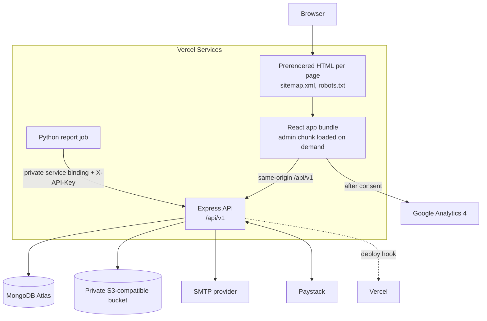
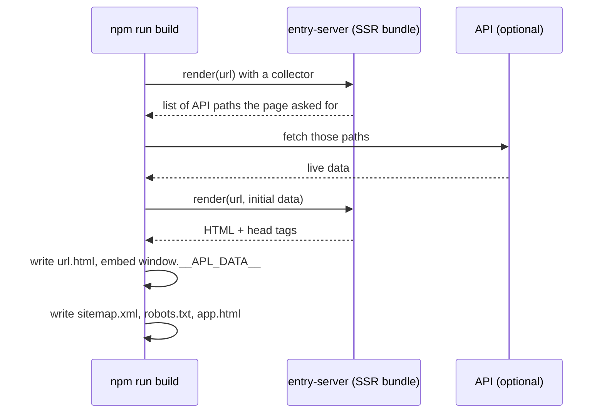
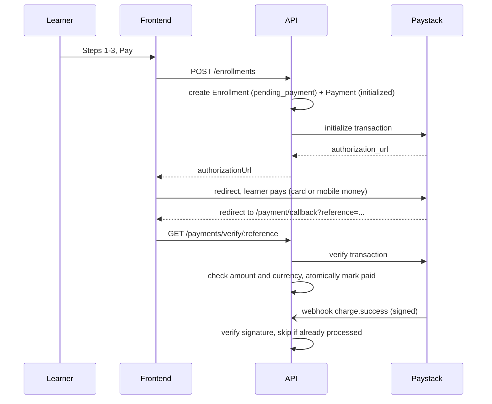

# Architecture

## Goals

1. Every public page must be fast and fully indexable by search engines.
2. Every conversion path must work for a first-time visitor in two or three steps, without an account.
3. Customer data and uploaded documents must be private by default.
4. The owner must be able to run the business from an admin dashboard, not from code.
5. Everything must run locally with no paid credentials, and switch to real providers through configuration only.

## System overview



## Frontend

- **React + Vite, plain CSS with design tokens.** No CSS framework, so the design stays distinctive and the CSS bundle small.
- **Routing:** React Router. Public pages are imported eagerly so they can be rendered on the server. The admin is a separate lazily loaded chunk that public visitors never download.
- **Data layer (`src/lib/data.jsx`):** `useResource(path, fallback)` returns bundled content from `shared/content` immediately, then revalidates against the API after mount. If the API is down the page still renders useful content.
- **Forms:** React Hook Form with Zod schemas that mirror the API's validation, plus server error mapping so API messages appear next to the right field.
- **Onboarding wizards:** `useWizard` keeps step state and saves a draft to `sessionStorage` (never files or consent ticks).

### Why prerendering, and how it works

A client-only React app sends an empty HTML shell. Google can render JavaScript, but slowly and not always; social platforms and many other crawlers cannot. Every public page is therefore rendered to static HTML at build time.



- Output uses Vercel `cleanUrls`: `/consulting/fractional-cto` is served from `consulting/fractional-cto.html`.
- `app.html` is an empty shell used as the fallback for the admin, pages whose content depends on the query string (thank you, payment callback, newsletter confirmation) and anything published after the last build.
- In the browser, prerendered pages are hydrated. Embedded data guarantees the first client render matches the HTML exactly.
- If the API is unreachable during the build, the bundled content snapshot is used, so a build never fails because of the API.
- `VERCEL_DEPLOY_HOOK_URL` lets the API trigger a rebuild (debounced 30 seconds) whenever published content changes.

## Backend

```
request -> requestId -> pino logger -> helmet -> CORS -> compression
        -> (Paystack webhook: raw body) -> JSON parser -> cookies -> sanitise
        -> /api/v1 router -> rate limiter -> module router -> validate (Zod) -> handler
        -> error handler (consistent JSON errors with requestId)
```

- **Modules** (`src/modules`) own routes and their Zod schemas. **Services** (`src/services`) hold integrations and reusable logic.
- **Provider abstractions:** `services/payments` (`mock`, `paystack`), `services/storage` (`local`, `s3`), `services/email` (`log`, `smtp`, `none`). Selected by environment variables.
- **Reports** (`services/reports.js`) are shared by the admin dashboard and the automation API, so the Python jobs never duplicate business logic.
- **Admin CRUD factory** (`lib/crud.js`) gives every collection consistent list, search, filter, pagination, CSV export, update, delete and audit behaviour.
- **Migrations** (`src/migrations`) run in order on start-up and are recorded in `_migrations`. **Seeding** uses `$setOnInsert`, so it never overwrites admin edits.
- **Responses:** `{ data, meta? }` on success, `{ error: { code, message, details?, requestId } }` on failure.

## Key flows

### Course enrollment with payment



### Research request

Multipart form: `payload` (JSON) plus up to 3 `files`. The API validates the payload, requires `integrityAcknowledged: true`, confirms the service exists, checks each file's extension, MIME type and signature, stores it under a random key in private storage with an expiry date, then notifies the student and the team.

### Admin session

Login returns a 15 minute access token (kept in memory only) and sets a 7 day httpOnly refresh cookie scoped to `/api/v1/auth`. The refresh token is stored hashed and rotated on every use; reuse of an old token fails. Refresh and logout require an `X-Requested-With: appilabs` header and an allowed `Origin`, which blocks cross-site request forgery.

## Scaling notes

- The API is stateless (sessions in MongoDB), so Vercel can scale function instances independently. Rate limits are in memory per instance; for many instances, switch `express-rate-limit` to a Redis store.
- Public GET responses send `Cache-Control` with `s-maxage`, ready for a CDN in front of the API.
- MongoDB indexes cover every admin filter and the slug lookups. Analytics events can be moved to a time-series collection or a TTL index as volume grows.
- Uploads go straight to object storage, so API instances keep no local state.
