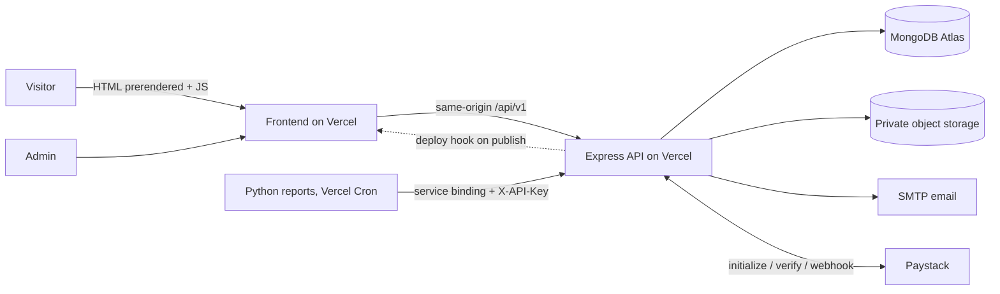

# AppiLabs

**Vision requires structure to scale.**

AppiLabs is a technology, data and training business based in Accra, Ghana. This repository is the complete platform behind it: a fast, search friendly marketing site, short conversion flows, a secure admin dashboard, an API with MongoDB, payments through Paystack, and Python automation for daily business reporting.

| Pillar | What it covers | Main conversion |
| --- | --- | --- |
| **Solutions** (we build) | Websites, web apps, MVPs, enterprise tools, APIs, automation, dashboards, e-commerce, maintenance | Project enquiry, consultation |
| **Consulting** (we advise) | Fractional CTO, IT strategy, data engineering, BI, data modelling, architecture reviews, cloud, due diligence | Consultation, retainer enquiry |
| **Academy** (we train and research) | Courses (Excel, SQL, Power BI, Python, analytics), corporate training, academic research support | Enrollment and payment, training enquiry, research request |

---

## Contents

1. [Features](#features)
2. [Technology](#technology)
3. [Architecture](#architecture)
4. [Repository structure](#repository-structure)
5. [Prerequisites](#prerequisites)
6. [Run it locally (step by step)](#run-it-locally-step-by-step)
7. [Create the first administrator](#create-the-first-administrator)
8. [Tests, lint and builds](#tests-lint-and-builds)
9. [Python automation](#python-automation)
10. [Payments (Paystack)](#payments-paystack)
11. [Email](#email)
12. [File uploads](#file-uploads)
13. [SEO and analytics](#seo-and-analytics)
14. [Editing content](#editing-content)
15. [Deploying (Vercel Services + MongoDB Atlas)](#deploying)
16. [Push to GitHub](#push-to-github)
17. [Troubleshooting](#troubleshooting)
18. [Known limitations and next steps](#known-limitations-and-next-steps)

Further reading: [ARCHITECTURE.md](ARCHITECTURE.md), [API.md](API.md), [DEPLOYMENT.md](DEPLOYMENT.md), [SECURITY.md](SECURITY.md), [docs/DATABASE.md](docs/DATABASE.md), [docs/DESIGN.md](docs/DESIGN.md), [automation/README.md](automation/README.md).

---

## Features

**Public website**
- Home, About, Solutions, Consulting and Academy overviews, 35 service detail pages, 8 course pages, corporate training, research support, insights (blog), work (case studies), resources, FAQ, contact, booking, privacy, terms, cookies, custom 404.
- Three short onboarding flows, each three steps, no account needed, with drafts kept if the page is refreshed:
  - **Start a project:** area, goal, contact details plus optional files.
  - **Enroll:** course, learner details, confirm and pay.
  - **Research request:** service and level, research details, contact details plus files and an academic integrity confirmation.
- Consultation booking, contact form, corporate training enquiry, downloadable lead magnets, double opt-in newsletter.
- Campaign attribution (UTM parameters, referrer, landing page, `?ref=` referral codes) attached to every enquiry.

**Admin dashboard** at `/admin`
- Overview metrics, lead status and source charts, recent activity.
- Leads, consultations, enrollments, research requests, subscribers and payments, each with search, filters, pagination, CSV export, status changes and internal notes.
- Content editor for services, courses, articles and case studies (changing a slug keeps the old URL working).
- Site settings (contact details, announcement bar, price visibility, booking on or off), user management with roles, audit log, first-party analytics.

**Backend**
- REST API under `/api/v1`, documented with OpenAPI at `/api/docs`.
- JWT access tokens plus rotating httpOnly refresh cookies, roles (owner, admin, editor), rate limiting, validation, MongoDB operator sanitising, honeypot spam protection, security headers, request IDs, structured logs, graceful shutdown.
- Paystack payments with backend verification, signed and idempotent webhooks, and a mock provider for demos.
- Private file uploads with type and content checks, S3-compatible storage, automatic deletion after the retention period.
- Email notifications by SMTP, or written to a local outbox in demo mode.
- Lightweight migrations and an idempotent seed that never overwrites admin edits.

**Automation (Python)**
- Stale inquiry alerts, daily lead summary, upcoming consultations, enrollment and revenue summary, weekly activity report. Output to console, Markdown files or email.

---

## Technology

| Layer | Choice |
| --- | --- |
| Frontend | React 18, Vite 5, React Router 6, React Hook Form + Zod, react-helmet-async, plain CSS with design tokens |
| SEO rendering | Build-time static prerendering of every public page (Vite SSR build + `scripts/prerender.mjs`) |
| Backend | Node.js 20+, Express 4, ES modules, Mongoose 8, Zod, Helmet, express-rate-limit, Multer, Pino, Nodemailer |
| Database | MongoDB 7 (MongoDB Atlas in production) |
| Payments | Paystack (cards and mobile money), provider abstraction |
| Storage | Local disk in development, any private S3-compatible bucket in production (Cloudflare R2, AWS S3, Backblaze B2) |
| Automation | Python 3.10+ standard library only |
| Tests | Vitest + Supertest (API), Vitest + Testing Library (UI), unittest (Python) |
| Hosting | Vercel Services (frontend, API and scheduled reports), MongoDB Atlas (database) |

---

## Architecture



More detail, including request flows and the prerendering pipeline, in [ARCHITECTURE.md](ARCHITECTURE.md).

---

## Repository structure

```
appilabs/
  shared/content/      Brand copy, services, courses, sample articles, FAQs, legal text (used by both apps)
  backend/
    src/
      config/          Environment validation, MongoDB connection
      middleware/      Auth, validation, rate limiting, uploads, errors, sanitising
      models/          Mongoose schemas
      modules/         Route modules (auth, content, leads, enrollments, research, admin, automation...)
      services/        Email, payments, storage, reports, audit, uploads
      migrations/      Ordered migrations and runner
      scripts/         seed, create-admin, migrate, purge-uploads
    tests/             API integration tests
    openapi.yaml       API specification
  frontend/
    src/
      pages/           Public pages
      admin/           Admin dashboard (code-split)
      components/      Layout, forms, content blocks
      lib/             API client, data layer, analytics, attribution, schemas
      styles/          Design tokens and stylesheets
      __tests__/       UI tests
    scripts/           prerender.mjs, serve.mjs, generate_assets.py
  automation/          Python reports and sample output
  docs/                Database and design documentation
  .github/workflows/   CI and optional scheduled reports
  docker-compose.yml   Local MongoDB
  render.yaml          Render blueprint (API + cron)
  vercel.json          Vercel configuration
```

---

## Prerequisites

Install these once:

1. **Node.js 20.11 or newer** (includes npm). Check with `node -v`. Download from nodejs.org.
2. **MongoDB**, any one of:
   - **Docker Desktop**, then `docker compose up -d mongo` (easiest), or
   - **MongoDB Community Server** installed locally, or
   - a free **MongoDB Atlas** cluster (no local install).
3. **Python 3.10+** for the automation (optional).
4. **Git** and **VS Code**. Recommended extensions are suggested automatically when you open the folder.

---

## Run it locally (step by step)

Open the project folder in VS Code, then open a terminal (Terminal > New Terminal).

**1. Install dependencies**

```bash
npm install            # root tools (runs both apps together)
npm run install:all    # backend and frontend dependencies
```

**2. Start MongoDB**

```bash
npm run db:up          # starts MongoDB 7 in Docker on port 27017
```

Skip this if you use a local install or Atlas.

**3. Configure the backend**

```bash
cp backend/.env.example backend/.env       # Windows PowerShell: copy backend\.env.example backend\.env
```

The defaults work for local development. For Atlas, replace `MONGODB_URI`. Set `AUTOMATION_API_KEY` to any long random string if you want to run the Python reports, and `SETUP_TOKEN` if you want to create the first admin in the browser.

**4. Configure the frontend**

```bash
cp frontend/.env.example frontend/.env
```

The defaults point at `http://localhost:4000`.

**5. Seed content and demo data**

```bash
npm run seed                          # services, courses, sample articles, case studies, settings
npm run seed --prefix backend -- --demo   # optional: sample leads, bookings, enrollments, research requests
```

Demo records are flagged `isDemo` and their names start with `Demo:`. Running the seed again never overwrites content you edited in the admin.

**6. Start both apps**

```bash
npm run dev
```

- Website: http://localhost:5173
- API: http://localhost:4000
- API docs: http://localhost:4000/api/docs
- Readiness check: http://localhost:4000/api/v1/ready

In demo mode, emails are written to `backend/storage/outbox/` and payments use the mock provider, so every flow works without credentials.

**7. Production preview (optional)**

```bash
npm run build --prefix frontend      # builds and prerenders every page
npm run preview --prefix frontend    # serves dist/ with the same routing as Vercel on http://localhost:4173
```

If an API URL is available during the build (`VITE_API_URL`), pages are prerendered with live content. In the Vercel Services setup the service binding is runtime-only, so the build uses bundled content and the browser fetches current data from the same-origin `/api` route.

---

## Create the first administrator

No credentials are shipped. Pick one method:

**Option A: command line (recommended)**

```bash
npm run create-admin
```

Answer the prompts, or run non-interactively:

```bash
ADMIN_NAME="Your Name" ADMIN_EMAIL=you@example.com ADMIN_PASSWORD='a-long-password' npm run create-admin
```

For the Render alternative, run the same command from the service Shell tab.

**Option B: in the browser**

1. Set `SETUP_TOKEN` to a long random value in the backend environment and restart the API.
2. Open `/admin`. While no users exist, the page asks for the setup token, your name, email and password.
3. Remove `SETUP_TOKEN` afterwards. Setup is refused once any user exists.

Then add colleagues under **Admin > Users**: *Admin* (content and customer data) or *Editor* (content only).

---

## Tests, lint and builds

```bash
npm test               # backend + frontend tests
npm run lint           # ESLint for backend + frontend
npm run build          # frontend production build with prerendering
```

Backend tests start an in-memory MongoDB automatically (downloaded on first run). To use your own server instead:

```bash
MONGODB_URI_TEST=mongodb://127.0.0.1:27017 npm test --prefix backend
```

Python tests:

```bash
cd automation && python -m unittest discover -s tests -t .
```

What is covered: health and readiness, migrations and seeding, contact and lead validation and creation, honeypot and operator injection handling, bookings, newsletter consent, lead magnets, setup and login, role-based access, refresh token rotation and CSRF header, audit logging and CSV export, course listing, enrollment with and without payment, backend payment verification, idempotency, amount mismatch, Paystack webhook signatures, research requests with integrity confirmation, file type and content checks, private file download, automation API, contact form and onboarding UI flows, attribution, pricing formats and safe Markdown rendering.

---

## Python automation

```bash
cd automation
cp .env.example .env          # set APPILABS_AUTOMATION_API_KEY = backend AUTOMATION_API_KEY
python -m appilabs_automation all
python -m appilabs_automation stale --hours 24 --notify file
```

Reports: `stale`, `daily`, `upcoming`, `enrollments`, `weekly`, or `all`. Delivery: `console` (default), `file` (Markdown in `automation/output/`), `smtp` (to your team). See `automation/sample_output/` and [automation/README.md](automation/README.md). The Python code only formats and delivers; all business rules live in the API, so numbers match the admin dashboard.

---

## Payments (Paystack)

| `PAYMENT_PROVIDER` | Behaviour |
| --- | --- |
| `mock` (default) | Simulated success for demos. The callback page says it is a demo. The API warns if used in production. |
| `paystack` | Real Paystack. Use a `sk_test_...` key to test, then `sk_live_...` after Paystack approves your business. |
| `none` | No online payment. Enrollments are recorded as *interested* and you follow up with an invoice. |

Setup:

1. Create a Paystack account and complete business verification.
2. Copy the secret key into `PAYSTACK_SECRET_KEY` in Vercel's backend environment variables.
3. In the Paystack dashboard set the **webhook URL** to `https://<your-api>/api/v1/payments/webhook/paystack` and the **callback URL** to `https://<your-site>/payment/callback`.
4. Make a test payment with a Paystack test card, then confirm the enrollment shows *Paid* in the admin.

The API verifies every transaction with Paystack before marking anything paid, checks the amount and currency, rejects unsigned webhooks, and processes each event once. Payment is live only after you complete these steps and see a successful test transaction.

---

## Email

`EMAIL_DRIVER=log` writes each email to `backend/storage/outbox/` (default). For real delivery set `EMAIL_DRIVER=smtp` and the `SMTP_*` values from any provider (Zoho Mail, Google Workspace, Brevo, Mailgun, Amazon SES). Set `ADMIN_NOTIFY_EMAIL` to receive an alert for every new enquiry. A failed email never blocks a form submission; it is logged instead.

---

## File uploads

Accepted: PDF, Word, Excel, PowerPoint, CSV, text and SPSS files, 10 MB each, 3 per request (configurable). Files are checked by extension, MIME type and file signature, stored under random names, never served at a public URL, downloadable only by owners and admins (each download is audited), and deleted after `UPLOAD_RETENTION_DAYS` (180 by default).

Hosted filesystems are often temporary, so production must use `STORAGE_DRIVER=s3` with a **private** bucket. Cloudflare R2 has a generous free tier:

```
STORAGE_DRIVER=s3
S3_ENDPOINT=https://<account-id>.r2.cloudflarestorage.com
S3_REGION=auto
S3_BUCKET=appilabs-uploads
S3_ACCESS_KEY_ID=...
S3_SECRET_ACCESS_KEY=...
```

---

## SEO and analytics

- Every public page is prerendered to static HTML at build time with its own title, meta description, canonical URL, Open Graph and Twitter tags, and structured data (ProfessionalService, Service, Course, Article, FAQPage, BreadcrumbList).
- `sitemap.xml` and `robots.txt` are generated on each build from `VITE_SITE_URL`.
- Renamed slugs redirect, so old links keep working.
- Set `VERCEL_DEPLOY_HOOK_URL` on the API and publishing content in the admin triggers a rebuild, so new pages are prerendered automatically.
- **Google Analytics 4:** set `VITE_GA_MEASUREMENT_ID`. It loads only after the visitor accepts analytics.
- **Search Console:** set `VITE_GSC_VERIFICATION` (HTML tag method), deploy, verify, then submit `https://<your-site>/sitemap.xml`.
- Tracked events: page views, service and course views, CTA clicks, form starts and submissions, consultation requests, enrollment starts, successful payments, newsletter sign-ups, resource downloads, research requests.

No platform can guarantee rankings. Publishing useful articles regularly (the Insights section is built for this) matters more than any setting.

---

## Editing content

- **Day to day:** use the admin dashboard. Changes appear on the live site immediately (pages fetch fresh data after loading) and in the prerendered HTML after the next build.
- **Initial copy:** edit files in `shared/content/`, then run `npm run seed` for new items. Existing records are not overwritten; edit those in the admin.
- **Before launch, replace:** contact details (Admin > Settings), demo prices (marked *Demo price*), illustrative case studies and sample articles (marked on the site), and the founder bio in `shared/content/site.js`. Have the legal pages reviewed by a lawyer.
- **Downloads:** edit `frontend/scripts/generate_assets.py` and run it (`pip install reportlab pillow`) to regenerate the PDFs and the social sharing image.

---

## Deploying

Full guide and checklist: [DEPLOYMENT.md](DEPLOYMENT.md). In short:

1. **MongoDB Atlas:** create a free cluster, a database user and network access, copy the connection string.
2. **Vercel:** Add New > Project > import the repo and keep the **root directory as the repository root**. The root `vercel.json` defines the frontend, API, automation, routing and daily cron.
3. Add the Vercel environment variables listed in [DEPLOYMENT.md](DEPLOYMENT.md). Do not set `APPILABS_API_URL`; Vercel injects it through the automation-to-backend service binding.
4. Allow the Vercel backend to connect to MongoDB Atlas, add your domain, create the first admin, configure Paystack webhooks and submit the sitemap.

`render.yaml` remains available if you later choose to host the API and report schedule on Render instead of Vercel. Do not deploy both sets of services against the same production database.

---

## Push to GitHub

```bash
git init
git add .
git commit -m "AppiLabs platform"
git branch -M main
git remote add origin https://github.com/<you>/appilabs.git
git push -u origin main
```

`.env` files, `node_modules`, build output and uploaded files are excluded by `.gitignore`. CI runs lint, tests and the build on every push.

---

## Troubleshooting

| Problem | Fix |
| --- | --- |
| `MongooseServerSelectionError` / `/ready` shows database unavailable | MongoDB is not running or `MONGODB_URI` is wrong. Run `npm run db:up`, or check Atlas network access allows Vercel's outbound connections. |
| Forms fail with a network error in the browser | API not running, or the site's origin is missing from `CORS_ORIGINS`. |
| Admin keeps returning to sign in after a refresh in production | Set `COOKIE_SECURE=true`, use HTTPS and set the site origin in `CORS_ORIGINS`. The frontend and API share one origin through Vercel routing. |
| Backend tests hang on first run | The in-memory MongoDB binary is downloading. Or set `MONGODB_URI_TEST`. |
| Uploaded files disappear after a deployment | Use `STORAGE_DRIVER=s3`; Vercel function filesystems are ephemeral. |
| Payment stays "pending" | Check the Paystack webhook URL and secret key, then use the verify link on the callback page again. |
| New article missing from the sitemap | Rebuild the frontend, or set `VERCEL_DEPLOY_HOOK_URL` so publishing triggers it. |
| `npm run seed` reports 0 new records | Expected after the first run. The seed only adds missing items. |
| Windows: `cp` not found | Use `copy` in PowerShell or the VS Code file explorer. |

---

## Known limitations and next steps

Honest status of the initial release:

- **Learning management:** courses, enrollment and payment are complete. Student accounts, lesson content, progress tracking, quizzes and certificates are not built yet; the `Enrollment` model is the foundation for them.
- **Scheduling:** consultation requests capture preferred times and admins confirm by setting a time. There is no live calendar sync (Google Calendar or Cal.com integration is a natural next step).
- **Newsletter sending:** subscribers are collected with double opt-in and exported as CSV. Sending campaigns is expected to happen in a dedicated tool (Brevo, Mailchimp) to protect deliverability.
- **Images in articles:** the editor stores a cover image URL; there is no media library upload yet.
- **Multi-currency:** prices are stored in minor units with a currency field, but the interface currently assumes GHS.
- **Validation in this build:** the backend test suite was run against FerretDB (a MongoDB wire-compatible server) because MongoDB could not be installed in the build environment. On your machine and in CI the tests run against real MongoDB.

Ideas for growth: case-study driven landing pages per industry, a referral programme using the existing `?ref=` attribution, WhatsApp click-to-chat tracking, payment plans for courses, and an affiliate or partner portal for corporate training.
