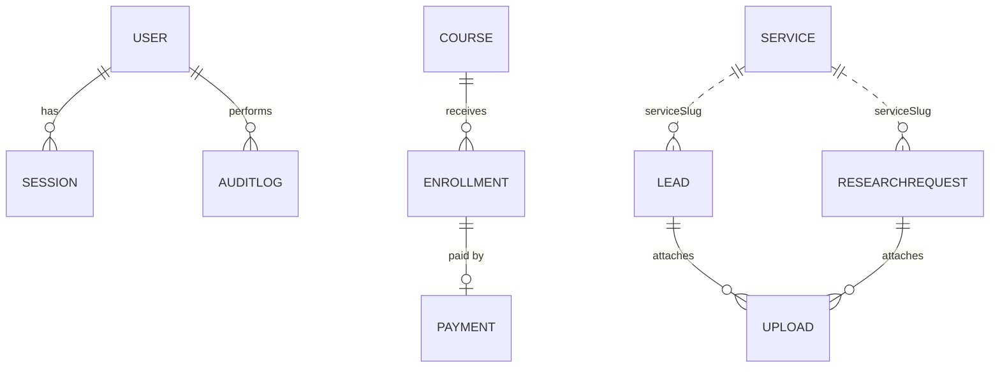

# Database (MongoDB)

Database name: `appilabs`. Schemas are defined with Mongoose in `backend/src/models`. Money is stored as integers in **minor units** (pesewas for GHS) to avoid rounding errors. All collections have `createdAt` and `updatedAt` unless noted.

| Collection | Purpose | Key fields | Indexes |
| --- | --- | --- | --- |
| `users` | Admin accounts | name, email, passwordHash (hidden), role (owner, admin, editor), active, lastLoginAt | email unique |
| `sessions` | Refresh tokens | user, tokenHash, expiresAt, revokedAt, userAgent, ip | tokenHash unique, user |
| `services` | Service catalogue | slug, previousSlugs, pillar, track, title, summary, outcome, deliverables, useCases, pricing {model, amount, currency, interval, isDemoPrice}, order, status, isDemo, seo | slug unique, previousSlugs, pillar, status |
| `courses` | Training catalogue | slug, previousSlugs, title, summary, level, format, duration, price, currency, audience, outcomes, prerequisites, modules, nextCohort, seats, status | slug unique, status |
| `blogposts` | Insights | slug, previousSlugs, title, excerpt, body (Markdown), tags, author, readingMinutes, status, publishedAt, isDemo, seo | slug unique, status |
| `casestudies` | Work | slug, title, pillar, sector, summary, challenge, approach, deliverables, result, status, isDemo | slug unique |
| `leads` | Contact, project, corporate training and resource enquiries | type, pillar, serviceSlug, name, email, phone, company, message, goal, timeline, budget, teamSize, files, status (new, contacted, qualified, converted, closed), internalNotes, firstRespondedAt, marketingConsent, attribution, isDemo | type, pillar, status, email, createdAt |
| `bookings` | Consultation requests | name, email, pillar, topic, preferredDates, timezone, mode, status (requested, confirmed, completed, cancelled), scheduledAt, internalNotes, attribution | status, scheduledAt |
| `enrollments` | Course sign-ups | course, courseSlug, courseTitle, learner details, status (interested, pending_payment, paid, cancelled, completed), amount, currency, paymentReference, paidAt | courseSlug, email, status, paymentReference |
| `payments` | Transactions | reference, provider, enrollment, amount, currency, status (initialized, success, failed, abandoned), channel, providerTransactionId, processedEvents, verifiedAt, failureReason | reference unique, status |
| `researchrequests` | Academic support requests | serviceSlug, academicLevel, discipline, institution, topic, requirements, deadline, supportMode, contact details, files, integrityAcknowledged, status, quoteAmount, internalNotes, firstRespondedAt | serviceSlug, status |
| `uploads` | Private file metadata | key (random storage key), originalName, mimeType, size, ownerType, ownerId, expiresAt, deletedAt | key unique, expiresAt |
| `subscribers` | Newsletter | email, status (pending, active, unsubscribed), confirmTokenHash, source, consentAt, confirmedAt | email unique, status |
| `analyticsevents` | First-party events | name, path, props, sessionId, attribution, createdAt | name, createdAt |
| `settings` | Single document `key: "site"` | businessName, email, phone, whatsapp, address, hours, serviceAreas, socials, showPrices, bookingEnabled, announcement | key unique |
| `auditlogs` | Admin activity | actor, actorEmail, action, entity, entityId, meta, ip, createdAt | createdAt |
| `_migrations` | Applied migrations | name, appliedAt | |

`attribution` (embedded): utmSource, utmMedium, utmCampaign, utmTerm, utmContent, referrer, landingPage, referralCode.

## Migrations

Files in `backend/src/migrations` named `NNN-description.js` export `up(db)`. They run in order on API start-up and with `npm run migrate`, and each is recorded in `_migrations` so it runs once. `001` creates all indexes; `002` is an example data migration. To add one, create `003-your-change.js`.

## Seeding

- `npm run seed`: inserts services, courses, sample articles, illustrative case studies and settings that do not exist yet. Existing records are never modified.
- `npm run seed -- --demo` (from `backend/`): also replaces demo pipeline records (`isDemo: true`). For local and staging use only.
